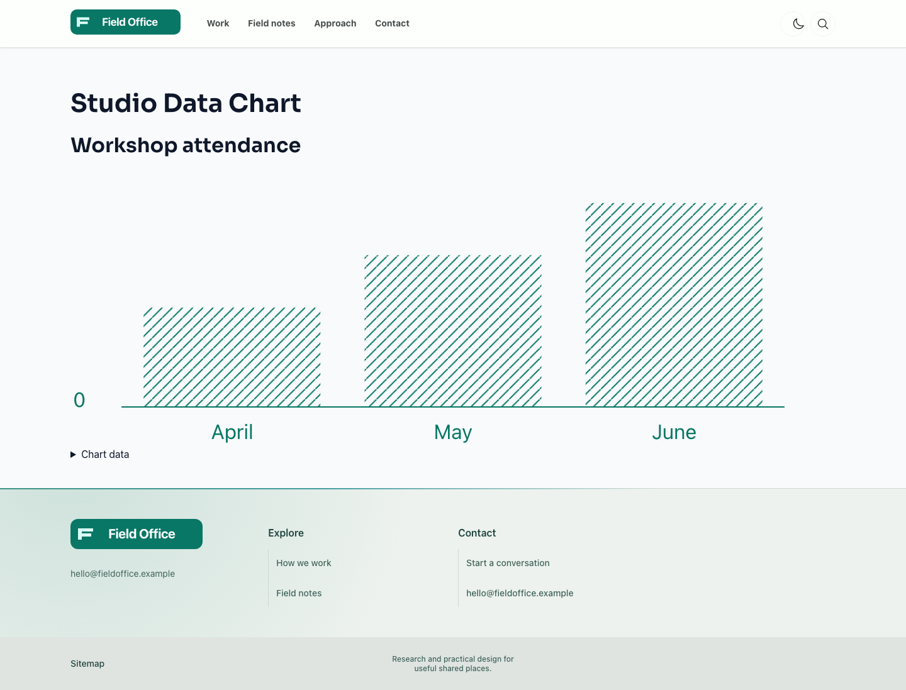
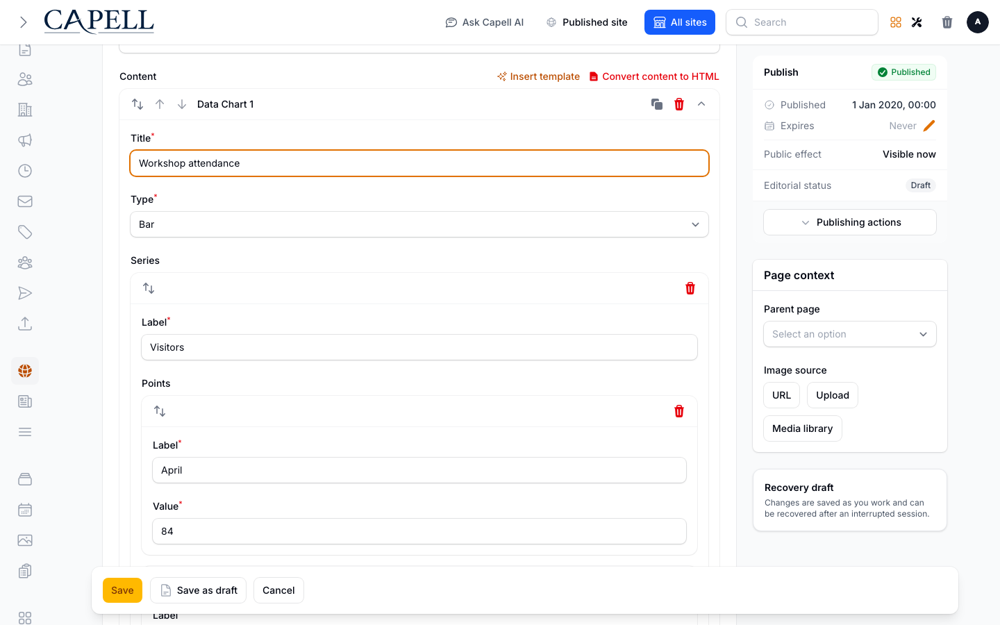

# Data Chart Widget

<!-- prettier-ignore-start -->

The figures in your annual report or your school's results can go on the page as a bar chart, a line chart or a donut. You type the numbers in, and the chart is drawn for you.

There's no spreadsheet to link and nothing updates on its own. One chart holds up to eight sets of figures, say one for each year, with up to fifty numbers in each. Bars can drop below zero to show a loss. Donuts can't show negative figures, and the form says so before you save.

Colours aren't yours to pick. Every chart is drawn in your site's main brand colour. Bars and donut slices are filled in turn with four patterns of fine lines and dots, and each line on a line chart gets its own dash. A chart printed without colour still reads.

Hovering over a bar or slice shows its exact value. Under the chart, a Chart data heading opens a table of every label and number for anyone who wants to quote a figure.

- **Price and availability:** Check current availability and price on the [Capell Marketplace listing](https://capell.app/marketplace/extensions/widget-data-chart).
- **Licence:** Check the licence terms on the [Capell Marketplace listing](https://capell.app/marketplace/extensions/widget-data-chart).
- **Requires:** `PHP ^8.4`, `capell-app/admin ^1.0`, `capell-app/core ^1.0.79`, `capell-app/frontend ^1.0.79`, `capell-app/layout-builder ^1.0`, `lorisleiva/laravel-actions ^2.8`, `spatie/laravel-package-tools ^1.0`.
- **Install:** `composer require capell-app/widget-data-chart:@beta`.

## Quick Start

1. Install the package: `composer require capell-app/widget-data-chart:@beta`.
2. Open a page, click **Layout builder**, **Add widgets**, then choose **Data Chart**.

## For Developers

Typed render data feeds a server-rendered Blade view, and focused tests check the generated SVG and output safety.

## Configure

This extension works without configuration. There is nothing to set after install.

## Limits And Pitfalls

- Install the required Capell packages at the versions in `composer.json`: `capell-app/admin ^1.0`, `capell-app/core ^1.0.79`, `capell-app/frontend ^1.0.79`, `capell-app/layout-builder ^1.0`.
- Keep public Blade and cached HTML free of authoring markers, model IDs, permissions, signed editor URLs, and lazy database queries.
- Custom write integrations must preserve invalidation for `widget-data-chart` cache tags.

## Screens And Workflow

- Data Chart Widget extension card (marketplace).
- Data Chart fields in Layout Builder (admin).
- Data Chart public output (frontend).
- Data Chart fields in Layout Builder with admin sidebar menu open (admin).

## Install Impact

- Required packages: `capell-app/admin`, `capell-app/core`, `capell-app/frontend`, `capell-app/layout-builder`.
- Admin navigation: no admin page or resource contribution is declared.
- Admin/editor extensions: `content-widget: WidgetDataChartContribution`.
- Permissions: no package permission declarations or Shield gates detected; host access rules still apply.
- Public routes: none declared.
- Database changes: no package migrations declared.
- Config: no package config files.
- Settings: no package settings declared.
- Queues or schedules: none declared.
- Cache tags: `widget-data-chart`.
- Commands: none declared.

## Troubleshooting

| Symptom | Likely cause | Check | Fix |
| --- | --- | --- | --- |
| Package surface is missing after install | Provider or manifest is not loaded | Confirm `capell.json`, package `composer.json`, and provider registration | Reinstall the package, refresh Composer autoload, and clear host caches |
| Public output leaks unexpected state | Render data, cache variation, or authoring boundary has regressed | Check public Blade, cache tags, and public-output safety tests | Move data loading out of Blade and rerun the package public-output tests |

## Upgrading

No manual steps between minor versions.

## Next Steps

- [Package docs](docs/README.md)
- [Overview](docs/overview.md)
- [Troubleshooting](#troubleshooting)
- [Developer reference](docs/reference.md)
- [Marketplace assets](docs/assets/marketplace/)
- [Capell content language plan](../../docs/CONTENT_LANGUAGE_PLAN.md)
- [Capell documentation design system](../../docs/DESIGN_SYSTEM.md)
- [Capell and package ERD notes](../../docs/erd/capell-and-package-erds.md)
- Related packages: [Layout Builder](../layout-builder/README.md).

<!-- prettier-ignore-end -->
